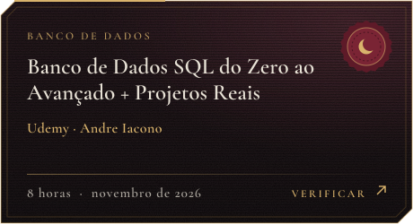
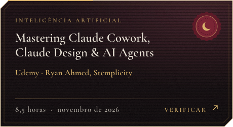
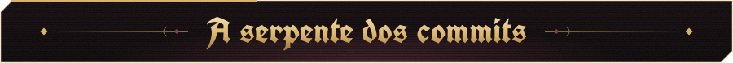

<div align="center">




<br/><br/>

<a href="https://www.linkedin.com/in/isaque-diniz-santos-365512386/"></a>
&nbsp;
<a href="mailto:isaquednz177@gmail.com"></a>

<br/><br/>


<br/><br/>


</div>

<p align="center"></p>

```ts
const billy = {
  nome: "Isaque Diniz",
  apelido: "Billy",
  status: "Estudante e entusiasta de tecnologia",
  areas: ["Inteligência Artificial", "Engenharia de Software"],
  linguagensEmAprendizado: ["Python", "Lua", "C", "JavaScript"],
  focoAtual: "Estudar e desenvolver pequenos softwares com propósito de aprendizado",
  acredito: "Todo avanço tecnológico começa com alguém curioso o suficiente pra testar",
};
```

> ✠ &nbsp;Estudando **Inteligência Artificial e Engenharia de Software**<br/>
> ✠ &nbsp;No momento: construindo **pequenos projetos** pra fixar o que aprendo na prática<br/>
> ✠ &nbsp;Entusiasta do **avanço tecnológico** em geral: gosto de acompanhar pra onde a coisa tá indo<br/>
> ✠ &nbsp;Fale comigo sobre: **IA, programação e qualquer tecnologia nova**

<p align="center"></p>

<div align="center">


<br/><br/>


</div>

<p align="center"></p>

<div align="center">

<a href="https://ude.my/UC-1da4e922-debc-4ffa-ae11-ed3d24a02624"></a>
<a href="https://ude.my/UC-11a04b75-2763-421c-a9ab-cf651f3147fb"></a>

</div>

<p align="center"></p>

<div align="center">
  
</div>

<br/>

<div align="center">


**Se curtiu alguma coisa por aqui, deixa uma ⭐**


</div>
